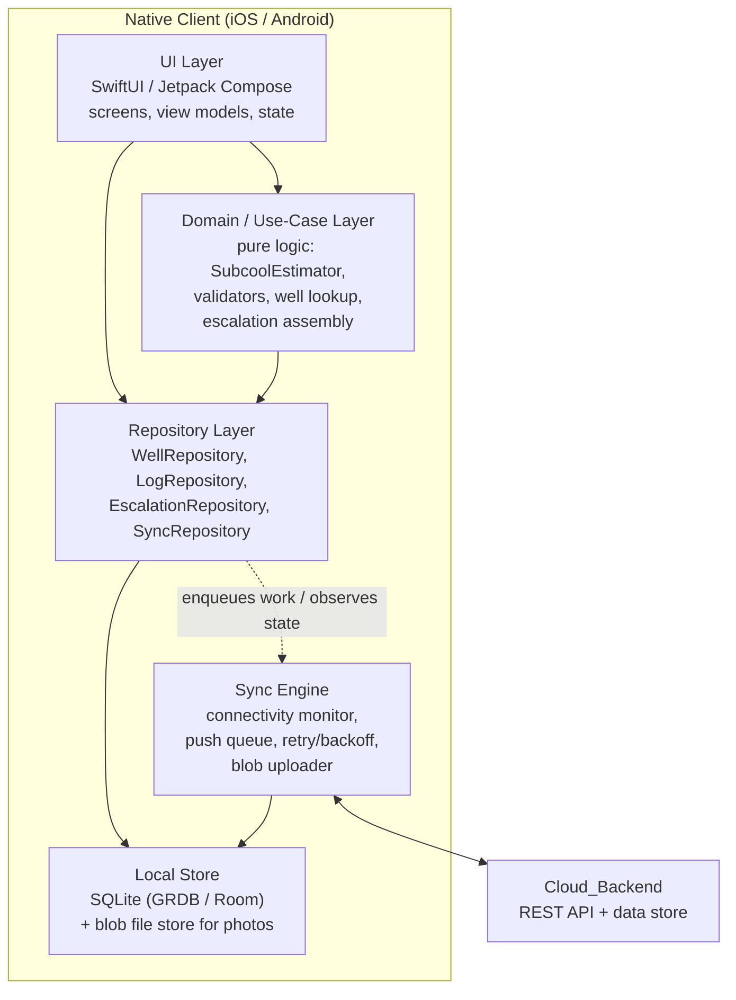
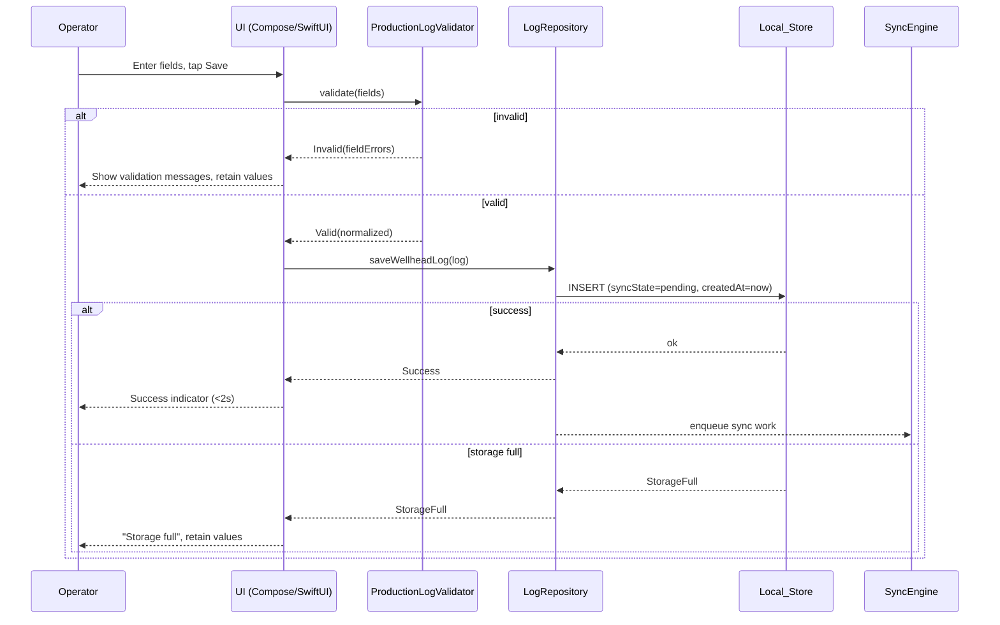
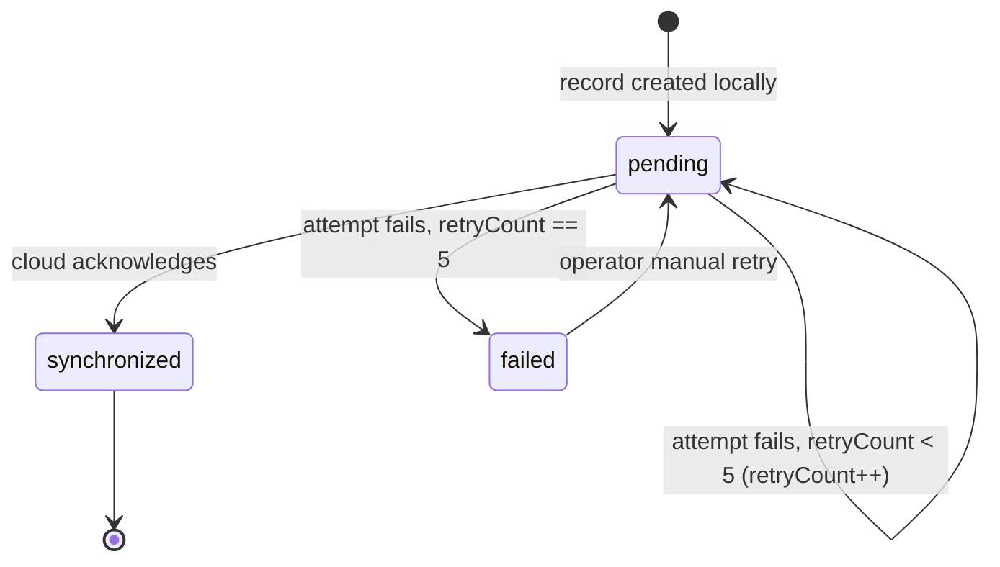
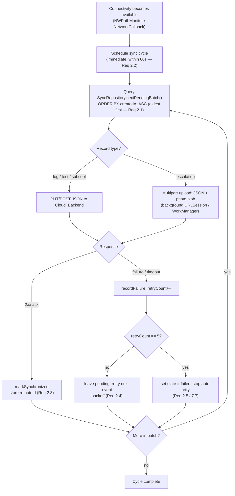
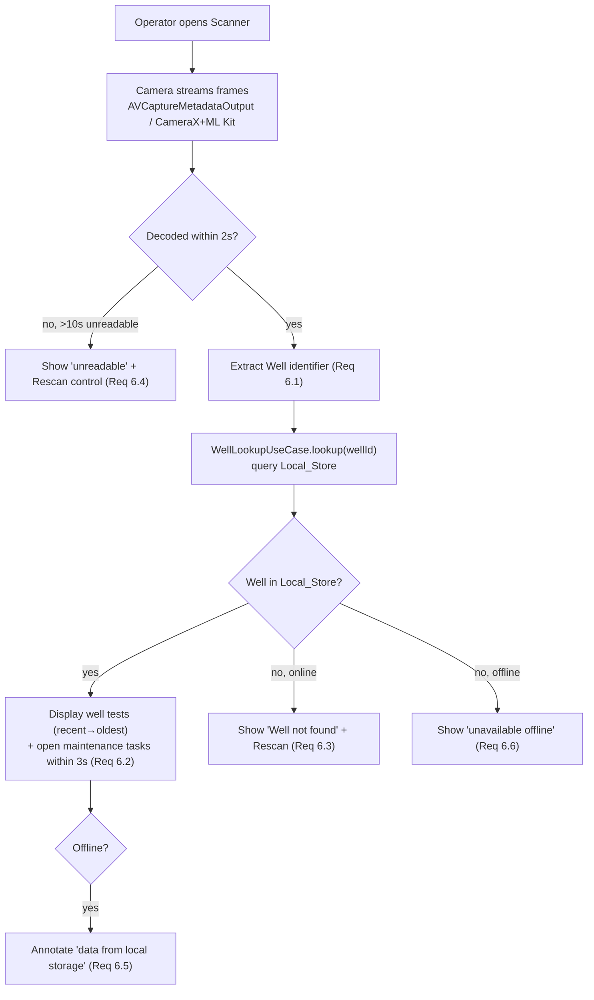

# Design Document

## Overview

SAGD WellTest Mobile is an offline-first field data capture system delivered as two native mobile clients — iOS (Swift + SwiftUI) and Android (Kotlin + Jetpack Compose) — backed by a shared `Cloud_Backend` REST API. Both clients implement the same layered architecture, the same local data model, the same per-record synchronization state machine, and the same domain logic (subcool estimation, validation rules, QR lookup, escalation capture). They differ only in the platform primitives used to realize each layer (persistence engine, background scheduler, camera/scanner, location provider).

The central design constraint is **offline-first correctness**: every capture operation must complete and persist locally with no network dependency, and synchronization is a background reconciliation process that never blocks the operator and never loses data. This drives three cross-cutting decisions:

1. **Local store is the source of truth on-device.** The UI reads and writes only the `Local_Store`. The `Sync_Service` observes the store and reconciles to the cloud asynchronously.
2. **Every syncable record carries its own sync-state machine** (`pending → synchronized | failed`) with a bounded retry count, so sync status is a property of each record rather than global app state.
3. **Domain logic is pure and platform-agnostic.** Subcool estimation and all field validation are deterministic functions over their inputs, which makes them portable across both codebases and directly testable with property-based testing.

This document defines the shared architecture and data model once, then calls out iOS-specific and Android-specific realizations where the platforms diverge. Design elements are mapped back to the requirements they satisfy throughout.

### Platform Technology Summary

| Concern | iOS | Android |
|---|---|---|
| Language / UI | Swift + SwiftUI | Kotlin + Jetpack Compose |
| Local persistence | SQLite via GRDB (recommended) or Core Data | SQLite via Room |
| Background sync | `URLSession` background sessions + `BGTaskScheduler` | `WorkManager` (with `CoroutineWorker`) |
| Connectivity detection | `NWPathMonitor` (Network framework) | `ConnectivityManager.NetworkCallback` |
| Camera / QR decode | `AVFoundation` (`AVCaptureMetadataOutput`) | CameraX + ML Kit barcode scanning |
| Location | `CoreLocation` (`CLLocationManager`) | `FusedLocationProviderClient` |

> GRDB is recommended on iOS over Core Data because the sync-state machine and oldest-first push ordering are expressed naturally as SQL over an explicit schema, matching the Room schema on Android and keeping the two codebases conceptually aligned. Core Data remains a viable alternative if the team prefers it; the data model section is written to map to either.

## Architecture

### Layered Architecture (shared across both platforms)

Both clients implement the same five layers. Dependencies point downward only; the domain layer has no knowledge of UI, persistence engines, or networking.



**Layer responsibilities:**

- **UI Layer** — Renders screens (well selection, production/injection log forms, subcool estimator, QR scan results, escalation capture) and reflects per-record sync state and the global offline indicator. Holds no business rules; delegates validation and computation to the domain layer. (Supports Req 1.1 success indicator, Req 2.6–2.8 state display, Req 5.2–5.3 display.)
- **Domain / Use-Case Layer** — Pure, platform-agnostic logic: `SubcoolEstimator`, field validators for production and injection logs, well-lookup use case, escalation assembly. Deterministic functions over inputs; no I/O. This is the primary target for property-based tests. (Supports Req 3, Req 4, Req 5, Req 6.2.)
- **Repository Layer** — The only component the UI uses to read/write data. Wraps the `Local_Store`, assigns sync metadata on write, and signals the sync engine that new work exists. Exposes observable queries so the UI updates reactively. (Supports Req 1, Req 2.3, Req 2.6–2.7.)
- **Local Store** — SQLite database (GRDB on iOS, Room on Android) plus a file-based blob store for escalation photos. Single source of truth on-device. (Supports Req 1.1–1.3.)
- **Sync Engine** — Background component that monitors connectivity, selects unsynchronized records oldest-first, pushes them (including photo blobs), handles acknowledgments and failures, and advances each record's sync-state machine. (Supports Req 2 in full, Req 7.6–7.7.)

### Platform realization of each layer

| Layer | iOS realization | Android realization |
|---|---|---|
| UI | SwiftUI views + `@Observable` / `ObservableObject` view models | Compose screens + `ViewModel` + `StateFlow` |
| Domain | Plain Swift structs/enums, pure functions | Plain Kotlin data classes/sealed classes, pure functions |
| Repository | Protocol-based repositories over GRDB `DatabaseQueue` | Interface-based repositories over Room DAOs |
| Local store | GRDB (SQLite) + files in app container (`Application Support`) | Room (SQLite) + files in app-internal storage |
| Sync engine | `URLSession` background config + `BGTaskScheduler` task; `NWPathMonitor` for connectivity | `WorkManager` unique work + `CoroutineWorker`; `NetworkCallback` for connectivity |

### Connectivity and background execution

- **iOS:** `NWPathMonitor` publishes connectivity transitions. On transition to "satisfied," the sync engine schedules an immediate sync and registers a `BGTaskScheduler` task so sync can proceed when the app is backgrounded. Photo blob uploads use a background `URLSession` so transfers survive app suspension. (Supports Req 2.2 60-second trigger, Req 7.6.)
- **Android:** A `ConnectivityManager.NetworkCallback` triggers enqueue of a unique `WorkManager` job constrained to `NetworkType.CONNECTED`. `WorkManager` guarantees execution across process death and reboots, and applies its own backoff. (Supports Req 2.2, Req 2.4, Req 7.6.)

Both platforms guarantee the Req 2.2 constraint — begin syncing within 60 seconds of connectivity restoration — by triggering on the connectivity callback directly rather than relying solely on periodic polling. A periodic fallback (BGTask / periodic WorkManager) covers missed callbacks.

## Components and Interfaces

The following interfaces are expressed in a platform-neutral form. Each maps to a Swift `protocol` and a Kotlin `interface`.

### Domain components

**SubcoolEstimator** (pure)
```
SubcoolEstimator:
  estimate(casingPressure: Double, pumpTemperature: Double) -> SubcoolResult
    // SubcoolResult = Success(subcoolValue, isFlashing) | OutOfRange | InvalidInput(field)
  saturationTemperature(pressure: Double) -> Double?   // nil/None if outside steam-table domain
```
Depends on an injected `SteamTable` (the reference dataset) and a `flashingThreshold` config value. (Req 5.)

**Validators** (pure)
```
ProductionLogValidator.validate(fields: ProductionLogInput) -> ValidationResult
InjectionLogValidator.validate(fields: InjectionLogInput) -> ValidationResult
EscalationValidator.validate(input: EscalationInput) -> ValidationResult
  // ValidationResult = Valid(normalizedRecord) | Invalid(list of FieldError)
```
(Req 3.2–3.5, Req 4.2–4.4, Req 7.2.)

**WellLookupUseCase**
```
lookup(wellId: String) -> WellLookupResult
  // Found(well, wellTests[desc], openMaintenanceTasks[]) | NotFound | UnavailableOffline
```
(Req 6.2, 6.3, 6.5, 6.6.)

### Repository components

```
WellRepository:
  getWell(id) -> Well?
  getWellTests(wellId) -> [WellTest]            // ordered most-recent first
  getOpenMaintenanceTasks(wellId) -> [MaintenanceTask]

LogRepository:
  saveWellheadLog(log) -> SaveResult            // Success | StorageFull | Failure(reason)
  saveWellTest(test) -> SaveResult

EscalationRepository:
  saveEscalation(escalation, photoData) -> SaveResult

SyncRepository:
  nextPendingBatch(limit) -> [SyncableRecord]   // oldest createdAt first
  markSynchronized(recordId)
  recordFailure(recordId)                        // increments retryCount; sets failed at 5
  manualRetry(recordId)                          // resets to pending, retryCount preserved or reset per policy
  observeSyncState(recordId) -> Stream<SyncState>
```
`SaveResult` distinguishes `StorageFull` so the UI can satisfy Req 1.5. All writes are transactional: a failed write leaves the prior persisted state untouched (Req 1.4).

### Sync engine component

```
SyncEngine:
  onConnectivityAvailable()      // triggered by NWPathMonitor / NetworkCallback
  runSyncCycle()                 // pull a batch oldest-first, push each, advance state machine
  uploadPhotoBlob(escalation)    // multipart upload via background session / WorkManager
```

### UI ↔ domain ↔ repository flow (example: save production log)


(Req 1.1, 1.4, 1.5, 3.5, 3.6.)

## Data Models

The data model is shared across both platforms. Each entity maps to a GRDB record type (iOS) and a Room `@Entity` (Android). All syncable records embed the same `SyncMetadata`.

### Entity: Well

| Field | Type | Notes |
|---|---|---|
| `id` | String (PK) | Unique well identifier; the value encoded in the `QR_Code` |
| `name` | String | Display name |
| `type` | Enum `WellType` | `production` \| `injection` |
| `padId` | String? | Pad / manifold grouping |
| `updatedAt` | Timestamp (UTC) | Last update from cloud pull |

Well records are primarily populated by the cloud **pull** (historical data). `type` drives which log form the UI presents (Req 3.1 vs 4.1). (Req 6.)

### Entity: WellTest

| Field | Type | Notes |
|---|---|---|
| `id` | UUID (PK) | Locally generated |
| `wellId` | String (FK → Well.id) | Associated well |
| `oilRatio` | Double | |
| `waterRatio` | Double | |
| `gasRatio` | Double | |
| `capturedAt` | Timestamp (UTC, 1s) | Capture time |
| `sync` | SyncMetadata | Embedded |

(Req 6.2 historical display; syncable per Req 2.)

### Entity: WellheadLog

A single table with a discriminator `logType`; production and injection fields are mutually exclusive and nullable. (Alternatively two tables; a discriminated single table keeps the sync queue uniform.)

| Field | Type | Notes |
|---|---|---|
| `id` | UUID (PK) | |
| `wellId` | String (FK) | Req 3.6 / 4.5 association |
| `logType` | Enum | `production` \| `injection` |
| `capturedAt` | Timestamp (UTC, 1s) | Req 3.6 / 4.5 |
| *Production fields* | | present when `logType = production` |
| `emulsionFlowRate` | Double? | Req 3.1, range 0.00–999,999.99 (Req 3.4) |
| `casingGasPressure` | Double? | Req 3.1, 3.4 |
| `espMotorTemperature` | Double? | Req 3.1, 3.4 |
| `waterCutPercent` | Double? | Req 3.1, range 0–100 (Req 3.2) |
| *Injection fields* | | present when `logType = injection` |
| `steamInjectionPressure` | Double? | Req 4.1, range 0–25,000 kPa (Req 4.3) |
| `steamTemperature` | Double? | Req 4.1, range 0–400 °C (Req 4.3) |
| `steamFlowRate` | Double? | Req 4.1, range 0–2,000 m³/day (Req 4.3) |
| `sync` | SyncMetadata | Embedded |

### Entity: SubcoolReading

| Field | Type | Notes |
|---|---|---|
| `id` | UUID (PK) | |
| `wellId` | String? (FK) | Optional association |
| `casingPressure` | Double | Input |
| `pumpTemperature` | Double | Input |
| `saturationTemperature` | Double | Derived from steam table |
| `subcoolValue` | Double | `saturationTemperature - pumpTemperature` (Req 5.1) |
| `isFlashing` | Bool | `subcoolValue <= flashingThreshold` (Req 5.3) |
| `capturedAt` | Timestamp (UTC, 1s) | |
| `sync` | SyncMetadata? | Embedded if persisted/synced |

### Entity: MaintenanceTask

| Field | Type | Notes |
|---|---|---|
| `id` | UUID (PK) | |
| `wellId` | String (FK) | |
| `description` | String | |
| `status` | Enum | `open` \| `closed` |
| `createdAt` | Timestamp (UTC) | |

Primarily populated by cloud pull; displayed on QR lookup (Req 6.2). "Open" tasks are those with `status = open`.

### Entity: Escalation

| Field | Type | Notes |
|---|---|---|
| `id` | UUID (PK) | |
| `wellId` | String (FK) | Required (Req 7.2) |
| `priority` | Enum | `high` \| `medium` \| `low`; required (Req 7.2) |
| `photoRef` | String | Path/key to blob in local file store |
| `latitude` | Double? | Decimal degrees (Req 7.1) |
| `longitude` | Double? | Decimal degrees (Req 7.1) |
| `locationUnavailable` | Bool | True when GPS timed out (Req 7.5) |
| `capturedAt` | Timestamp (UTC, 1s) | Req 7.1 |
| `sync` | SyncMetadata | Embedded; includes blob upload state |

### Embedded: SyncMetadata

| Field | Type | Notes |
|---|---|---|
| `syncState` | Enum | `pending` \| `synchronized` \| `failed` (Req 2.5, 2.6) |
| `retryCount` | Int | 0–5; sync fails permanently at 5 (Req 2.5) |
| `createdAt` | Timestamp (UTC) | Drives oldest-first push ordering (Req 2.1) |
| `lastAttemptAt` | Timestamp? | For backoff scheduling |
| `remoteId` | String? | Set on cloud acknowledgment |

**Design rationale:** `createdAt` is the single ordering key for the push queue, giving a deterministic oldest-first order (Req 2.1). `retryCount` is per-record and bounded at 5, isolating a poison record from blocking others (Req 2.5). Keeping `SyncMetadata` embedded uniformly across all syncable entities lets the sync engine treat the push queue as one homogeneous stream regardless of record type.

### Blob (photo) storage

Escalation photos are **not** stored as BLOB columns. They are written as files in app-private storage, referenced by `photoRef`. This keeps the SQLite database small and lets the background uploader stream the file directly as multipart without loading it into memory. The DB row and the blob file are written in a defined order (blob first, then row referencing it) so a crash never leaves a row pointing at a missing file (Req 7.3, 7.4).

## Offline-First Local Persistence

### Schema and transactions

The schema above is created via GRDB migrations (iOS) and Room migrations (Android). All saves run in a single transaction:

- On success: the record is committed with `syncState = pending`, `createdAt = now`, `retryCount = 0`, and the UI receives `Success` to show the confirmation indicator within 2 seconds (Req 1.1).
- On failure (I/O error): the transaction rolls back; the prior persisted state is untouched and the UI receives `Failure` while retaining the operator's in-form data (Req 1.4).
- On insufficient storage: a pre-write free-space check (and catch of the platform disk-full error) returns `StorageFull`; nothing is written and the form data is retained (Req 1.5).

### Per-record sync-state machine



- A record enters `pending` on creation (Req 2.6).
- A cloud acknowledgment moves it to `synchronized`; the store is updated within 5 seconds of the ack (Req 2.3), and the UI reflects the change within 5 seconds (Req 2.7).
- A failed attempt increments `retryCount` and keeps the record (no data loss, Req 2.4). On the 5th consecutive failure the state becomes `failed` and automatic retries stop (Req 2.5, Req 7.7).
- A `failed` record returns to `pending` only via operator-triggered manual retry (Req 2.5).

### Restart reload

On launch, the client opens the existing SQLite database and the UI queries the repositories directly; no migration of in-memory state is needed because the store is the source of truth. Every record persisted before restart is immediately available for viewing and editing, and records in `pending`/`failed` remain in those states and are re-picked-up by the sync engine on the next connectivity event (Req 1.3, Req 2.4).

## Sync Engine

### Trigger and ordering



### Connectivity detection

- iOS: `NWPathMonitor` on a dedicated queue; `.satisfied` paths trigger `onConnectivityAvailable()`. Loss of connectivity flips the global offline indicator within 5 seconds (Req 2.8).
- Android: `NetworkCallback.onAvailable` / `onLost`; `onAvailable` enqueues the unique sync work; `onLost` publishes the offline indicator (Req 2.8).

### Push ordering and acknowledgment

Records are pushed strictly in ascending `createdAt` order (Req 2.1). A record is considered done only on an explicit 2xx acknowledgment from the `Cloud_Backend`; on ack the engine sets `syncState = synchronized` and stores the returned `remoteId` within 5 seconds (Req 2.3). Idempotency is guaranteed by sending the client-generated record `id`: a retried push of an already-acknowledged record is recognized by the backend via the `id` and returns success without creating a duplicate (see Correctness Property: sync idempotency).

### Retry and backoff

On any failure, `retryCount` increments and the record stays in the store (Req 2.4). Automatic retries occur on subsequent connectivity events with exponential backoff keyed on `lastAttemptAt` (e.g., 1s, 4s, 16s, 64s, 256s). After 5 consecutive failures the record transitions to `failed` and is excluded from automatic batches until a manual retry resets it to `pending` (Req 2.5, Req 7.7).

### Photo / blob upload

Escalation sync uses multipart: a JSON part (escalation fields) plus a binary part streamed from the blob file. On iOS this runs on a background `URLSession` so it survives suspension; on Android it runs inside the `CoroutineWorker`, which `WorkManager` guarantees to completion. The escalation row is marked `synchronized` only after the multipart request (including the photo) is acknowledged (Req 7.6).

### Conflict handling

Field-captured records (tests, logs, subcool readings, escalations) are **append-only, operator-owned** events, so update conflicts do not arise for them; the backend treats a push with a known `id` as a no-op (idempotent). For **pulled** reference data (Well, MaintenanceTask), the cloud is authoritative: pulls overwrite local copies using `updatedAt` as a last-writer-wins marker. Because captured records and reference data are disjoint in ownership, there is no bidirectional merge to resolve.

## Subcool Estimator

### Inputs, output, and definition

Given a numeric casing pressure `P` and numeric pump temperature `Tpump`:

1. Compute `Tsat = saturationTemperature(P)` from the `Steam_Table`.
2. `Subcool_Value = Tsat − Tpump` (degrees Celsius) (Req 5.1).
3. `isFlashing = Subcool_Value <= flashingThreshold` (configurable; Req 5.3).

### Steam-table lookup and interpolation

The `Steam_Table` is a monotonic dataset of (saturation pressure → saturation temperature) pairs bundled with the app. Saturation temperature increases monotonically with saturation pressure, which the interpolation preserves.

- Lookup finds the bracketing pair `(P0, T0)` and `(P1, T1)` such that `P0 <= P <= P1`.
- **Linear interpolation** within the bracket:
  `Tsat = T0 + (P − P0) * (T1 − T0) / (P1 − P0)`.
- If `P` exactly equals a table point, that point's temperature is returned.
- If `P` is below the minimum or above the maximum table pressure, the lookup returns "out of range" (None/nil), and the estimator rejects the submission with an out-of-range message while retaining entered values (Req 5.4).

> Linear interpolation is chosen over higher-order fits because the steam table is dense enough over the operating range that linear error is negligible for field use, and linearity preserves the monotonic relationship exactly — a property we assert in testing. A denser bundled table reduces interpolation error further without code change.

### Algorithm

```
function estimateSubcool(P, Tpump, steamTable, flashingThreshold):
    if P is empty or not numeric: return InvalidInput("casingPressure")
    if Tpump is empty or not numeric: return InvalidInput("pumpTemperature")

    if P < steamTable.minPressure or P > steamTable.maxPressure:
        return OutOfRange("casingPressure")

    (P0, T0, P1, T1) = steamTable.bracket(P)      // P0 <= P <= P1
    if P1 == P0:
        Tsat = T0
    else:
        Tsat = T0 + (P - P0) * (T1 - T0) / (P1 - P0)

    subcool = Tsat - Tpump
    isFlashing = subcool <= flashingThreshold
    return Success(subcool, isFlashing)
```

### Out-of-range and invalid input

- Non-numeric or empty inputs → `InvalidInput(field)`; the UI shows a validation message naming the invalid field and retains entered values (Req 5.5).
- Pressure outside the steam-table domain → `OutOfRange`; submission rejected, values retained, out-of-range message shown (Req 5.4).
- The calculation itself is pure and returns within well under the 1-second display requirement (Req 5.2); the flashing-zone alert is a UI state driven by `isFlashing` (Req 5.3).

## QR Scanning Flow



- Decoding targets a 2-second budget from code entry into view (Req 6.1); if no decode succeeds within 10 seconds the scan is reported unreadable with a rescan control (Req 6.4).
- A decoded identifier is looked up against the `Local_Store` only — lookup never requires the network (Req 6.5). On a hit, historical `WellTest` records ordered most-recent-first and all `open` `MaintenanceTask` records are shown within 3 seconds (Req 6.2).
- Miss handling branches on connectivity: online miss → "not found" + rescan (Req 6.3); offline miss → "unavailable offline" (Req 6.6). On an offline hit, the view is annotated as sourced from local storage (Req 6.5).

Platform decode: iOS uses `AVCaptureMetadataOutput` with `.qr`/barcode object types; Android uses CameraX `ImageAnalysis` feeding ML Kit's barcode scanner. Both deliver the decoded string to the same `WellLookupUseCase`.

## Geotagged Photo Escalation Flow

```mermaid
flowchart TD
    A["Operator captures photo"] --> B["Start location request<br/>CoreLocation / FusedLocationProvider"]
    B --> C{GPS fix within 30s?}
    C -->|yes| D["Attach lat/long (decimal degrees) + UTC timestamp (Req 7.1)"]
    C -->|no| E["Set locationUnavailable=true, allow proceed (Req 7.5)"]
    D --> F["Operator selects priority + well"]
    E --> F
    F --> G{priority in {High,Med,Low} AND wellId set?}
    G -->|no| H["Block save, retain data, show missing-selection message (Req 7.2)"]
    G -->|yes| I["Write photo blob to file store, then INSERT row (pending)"]
    I --> J{Persist OK?}
    J -->|no| K["Retain data, leave unsaved, show error (Req 7.4)"]
    J -->|yes| L["Persisted within 5s (Req 7.3)"]
    L --> M["On connectivity: multipart push JSON + photo (Req 7.6)"]
    M --> N{5 consecutive failures?}
    N -->|yes| O["state = failed, stop auto retry (Req 7.7)"]
```

- Photo capture attaches decimal-degree latitude/longitude and a UTC capture timestamp (Req 7.1). A GPS fix is bounded at 30 seconds; on timeout the escalation records `locationUnavailable` and the operator may proceed (Req 7.5).
- Save is blocked unless a priority (High/Medium/Low) and an associated well are both present, retaining entered data and naming the missing selection (Req 7.2).
- Persistence writes the blob file first, then the DB row referencing it, within 5 seconds (Req 7.3); a persistence failure leaves the escalation unsaved with data retained and an error shown (Req 7.4).
- Sync pushes the escalation and its photo via multipart and advances the same sync-state machine, failing permanently after 5 attempts (Req 7.6, 7.7).

## Cloud Backend API Contract

All endpoints accept the client-generated record `id` for idempotency. Captured-data pushes are idempotent on `id`. Authentication is via a bearer token (details out of scope for this design).

### Push endpoints

| Method | Path | Body | Purpose |
|---|---|---|---|
| `POST` | `/v1/well-tests` | JSON `WellTest` (incl. `id`, `wellId`, ratios, `capturedAt`) | Push a well test (Req 2.1) |
| `POST` | `/v1/wellhead-logs` | JSON `WellheadLog` (discriminated by `logType`) | Push a production/injection log (Req 3.6, 4.5) |
| `POST` | `/v1/subcool-readings` | JSON `SubcoolReading` | Push a subcool reading (optional persistence) |
| `POST` | `/v1/escalations` | `multipart/form-data`: `metadata` (JSON) + `photo` (binary) | Push escalation + photo (Req 7.6) |

**Acknowledgment contract:** On success each endpoint returns `200/201` with `{ "id": "<clientId>", "remoteId": "<serverId>", "status": "accepted" }`. A repeated push of an already-accepted `id` returns `200` with the same `remoteId` and does not create a duplicate (idempotency; supports Req 2.3 and sync-idempotency property).

### Pull endpoints

| Method | Path | Response | Purpose |
|---|---|---|---|
| `GET` | `/v1/wells/{wellId}` | JSON `Well` | Well reference data |
| `GET` | `/v1/wells/{wellId}/well-tests?order=desc` | JSON `[WellTest]` newest-first | Historical tests for QR lookup (Req 6.2) |
| `GET` | `/v1/wells/{wellId}/maintenance-tasks?status=open` | JSON `[MaintenanceTask]` | Open tasks for QR lookup (Req 6.2) |
| `GET` | `/v1/wells?updatedSince={ts}` | JSON `[Well]` | Incremental reference-data sync |

Pulled data is cached in the `Local_Store` so QR lookup works offline (Req 6.5). Error responses use standard HTTP status codes; `409`/`422` on push are treated as non-retryable and move the record toward `failed`, while `5x`/timeouts are retryable (count toward the 5-attempt limit).

## Correctness Properties

*A property is a characteristic or behavior that should hold true across all valid executions of a system — essentially, a formal statement about what the system should do. Properties serve as the bridge between human-readable specifications and machine-verifiable correctness guarantees.*

The domain layer (subcool estimation, validators, sync-state machine, repositories over the local store) is pure and deterministic, which makes these properties directly executable with a property-based testing library on each platform. Properties below were derived from the prework analysis; redundant criteria were consolidated (e.g., production and injection validators share the same numeric-format and save-blocking shape; the sync-state machine covers Req 2.4–2.6 and 7.7 uniformly).

### Property 1: Persistence round-trip

*For any* valid syncable record (well test, wellhead log, subcool reading, or escalation), saving it to the `Local_Store` and then reloading from the store (including after the store is closed and reopened) yields a record whose captured fields are equal to those originally saved.

**Validates: Requirements 1.1, 1.3, 7.3**

### Property 2: Capture requires no network

*For any* valid record, create/view/edit operations through the repository layer complete successfully with the network layer unavailable, producing the same persisted result as when the network is available.

**Validates: Requirements 1.2**

### Property 3: Atomic save — failure preserves prior state

*For any* prior persisted store state and any injected write failure during a save, after the failed save the persisted store state is unchanged (no partial write) and the operation reports failure.

**Validates: Requirements 1.4, 7.4**

### Property 4: Oldest-first push ordering

*For any* set of pending records with distinct creation times, the sync engine pushes them to the `Cloud_Backend` in strictly ascending `createdAt` order.

**Validates: Requirements 2.1**

### Property 5: Acknowledgment yields synchronized state

*For any* pending record, receiving a successful acknowledgment from the `Cloud_Backend` transitions that record's sync state to `synchronized` and records the returned `remoteId`.

**Validates: Requirements 2.3**

### Property 6: No data loss on failed sync

*For any* pending record and any sync attempt that fails, the record remains in the `Local_Store` with its captured payload unchanged and remains eligible for a later retry.

**Validates: Requirements 2.4**

### Property 7: Five-retry boundary and manual-retry reset

*For any* syncable record (including escalations) subjected to N consecutive failed sync attempts, the record's state is `failed` if and only if N ≥ 5; a record in `failed` is excluded from automatic push batches, and an operator-triggered manual retry returns it to `pending` so it is again eligible for automatic push.

**Validates: Requirements 2.5, 7.7**

### Property 8: Pending-state invariant

*For any* record that has been created locally, has not been acknowledged, and has fewer than 5 consecutive failures, its sync state is `pending`.

**Validates: Requirements 2.6**

### Property 9: Sync idempotency

*For any* record, pushing it to the `Cloud_Backend` and then pushing the same record (same client `id`) again results in a single stored record on the backend with the same `remoteId`, and the record's final local state is `synchronized` (duplicate pushes cause no duplicate and no state regression).

**Validates: Requirements 2.3, 2.4**

### Property 10: Numeric-format validation

*For any* input string for a numeric field (production emulsion flow rate, casing gas pressure, ESP motor temperature; injection pressure, temperature, flow rate), the validator accepts the entry if and only if the string consists solely of digits with at most one decimal point and an optional leading minus sign; otherwise it rejects the entry and preserves the previously accepted value.

**Validates: Requirements 3.3, 4.2**

### Property 11: Range validation per field

*For any* numeric value entered into a bounded field, the validator rejects the entry if and only if the value falls outside that field's accepted range — water cut percentage outside [0, 100]; production fields outside [0.00, 999,999.99]; steam injection pressure outside [0, 25,000]; steam temperature outside [0, 400]; steam flow rate outside [0, 2,000] — and otherwise accepts it.

**Validates: Requirements 3.2, 3.4, 4.3**

### Property 12: Save blocked exactly on invalid fields

*For any* production or injection wellhead log form, the save succeeds if and only if every required field is non-empty and holds an accepted value; when the save is blocked, the set of fields reported as needing correction equals exactly the set of empty or rejected fields, and all entered values are retained.

**Validates: Requirements 3.5, 4.4**

### Property 13: Valid log association and timestamp

*For any* valid wellhead log (production or injection) that is saved, the persisted record is associated with the selected `Well` identifier and carries a capture timestamp expressed in UTC at one-second precision.

**Validates: Requirements 3.6, 4.5**

### Property 14: Subcool definition

*For any* casing pressure within the `Steam_Table` domain and any pump temperature, the computed `Subcool_Value` equals the interpolated saturation temperature at that pressure minus the pump temperature.

**Validates: Requirements 5.1**

### Property 15: Subcool monotonicity

*For any* two casing pressures within the `Steam_Table` domain with a fixed pump temperature, a higher pressure yields a `Subcool_Value` greater than or equal to that of the lower pressure (saturation temperature is non-decreasing in pressure); and *for any* fixed casing pressure, increasing the pump temperature strictly decreases the `Subcool_Value`.

**Validates: Requirements 5.1**

### Property 16: Flashing-zone classification

*For any* computed `Subcool_Value`, the result is classified as flashing if and only if the value is at or below the configured `Flashing_Zone` threshold.

**Validates: Requirements 5.3**

### Property 17: Out-of-range pressure rejection

*For any* casing pressure outside the `Steam_Table` pressure domain, the `Subcool_Estimator` rejects the submission with an out-of-range result and produces no `Subcool_Value`; *for any* pressure inside the domain (with valid temperature) it produces a value.

**Validates: Requirements 5.4**

### Property 18: Invalid subcool input rejection

*For any* empty or non-numeric casing pressure or pump temperature, the `Subcool_Estimator` rejects the submission and the rejection identifies exactly the invalid field(s).

**Validates: Requirements 5.5**

### Property 19: QR lookup ordering and open-task filtering

*For any* `Well` in the `Local_Store` with an arbitrary set of well tests and maintenance tasks, a successful lookup returns the well's tests ordered from most recent to oldest and returns exactly those maintenance tasks whose status is open.

**Validates: Requirements 6.2**

### Property 20: QR lookup independent of connectivity

*For any* `Well` present in the `Local_Store`, the lookup returns the same `Found` result (same well, same ordered tests, same open tasks) regardless of whether network connectivity is available.

**Validates: Requirements 6.5**

### Property 21: Escalation geotag attachment

*For any* escalation captured while a GPS fix is available, the saved escalation carries the provided decimal-degree latitude and longitude and a UTC one-second-precision capture timestamp.

**Validates: Requirements 7.1**

### Property 22: Escalation save requires priority and well

*For any* escalation, the save succeeds if and only if a priority of High, Medium, or Low is selected and an associated `Well` identifier is present; when blocked, the reported missing-selection set equals exactly the set of absent selections and all entered data is retained.

**Validates: Requirements 7.2**

### Property 23: Location-unavailable fallback

*For any* escalation captured when no GPS fix is produced within the 30-second bound, the saved escalation has its location-unavailable indicator set, has null coordinates, and the save still succeeds.

**Validates: Requirements 7.5**

### Property 24: Escalation photo included in push

*For any* escalation pushed to the `Cloud_Backend`, the push payload includes both the escalation metadata and photo bytes identical to those stored in the local blob store.

**Validates: Requirements 7.6**

## Error Handling

Error handling is defined per layer and mapped to requirements.

### Local store errors
- **Write failure (I/O):** All saves are transactional; a failure rolls back so the prior persisted state is unchanged, and the repository returns `Failure(reason)`. The UI retains in-form data and shows an error naming the affected record. (Req 1.4, 7.4; Property 3.)
- **Insufficient storage:** A pre-write free-space check and catch of the platform disk-full error return `StorageFull`; nothing is written and in-form data is retained with a storage-full message. (Req 1.5.)
- **Blob/row ordering:** The photo blob is written before the referencing row; a crash between the two leaves at most an orphan blob (garbage-collected on next launch), never a row pointing at a missing file. (Req 7.3, 7.4.)

### Validation errors
- Field validators return a `ValidationResult` with a list of `FieldError`s; the UI renders one message per offending field, retains all entered values, and blocks the save. (Req 3.2–3.5, 4.2–4.4, 5.5, 7.2; Properties 10–13, 18, 22.)

### Subcool estimator errors
- `InvalidInput(field)` for empty/non-numeric values (Req 5.5); `OutOfRange` for pressures outside the steam-table domain (Req 5.4). Both retain entered values and surface a specific message. (Properties 17, 18.)

### Sync errors
- **Retryable** (`5xx`, timeouts, connectivity drop): increment `retryCount`, keep the record, retry on the next connectivity event with exponential backoff; transition to `failed` at 5 consecutive failures. (Req 2.4, 2.5, 7.7; Properties 6, 7.)
- **Non-retryable** (`409`, `422` validation rejection by backend): move the record toward `failed` without consuming the full retry budget, surfacing it for operator attention/manual retry.
- **Duplicate acknowledgment:** handled idempotently via client `id`; no duplicate records, no state regression. (Property 9.)

### Scanner and location errors
- Undecodable code after 10 seconds → unreadable message + rescan control (Req 6.4). Decoded-but-unknown well → not-found (online) or unavailable-offline (offline) branches (Req 6.3, 6.6). GPS timeout at 30 seconds → location-unavailable fallback (Req 7.5; Property 23).

### Connectivity
- Loss of connectivity publishes the offline indicator within 5 seconds (Req 2.8); restoration triggers a sync cycle within 60 seconds (Req 2.2).

## Testing Strategy

Testing uses a three-tier approach on each platform, with the shared domain logic as the primary property-based-testing target.

### Property-based testing (domain + repository + sync logic)
- **Libraries:** SwiftCheck (or `swift-testing` with a generator layer) on iOS; Kotlin's `kotest-property` (or jqwik via JVM test module) on Android. The team MUST use an existing PBT library and NOT implement property-based testing from scratch.
- **Coverage:** Properties 1–24 above. Each correctness property is implemented by exactly one property-based test.
- **Iterations:** Each property test runs a minimum of 100 generated iterations.
- **Tagging:** Each property test is tagged with a comment referencing its design property, in the format: **Feature: sagd-welltest-mobile, Property {number}: {property_text}**.
- **Mocks for I/O:** Sync properties (4–9, 24) run against an in-memory recording stub of the `Cloud_Backend` so 100+ iterations are cheap and deterministic; the local store runs against a temporary on-disk or in-memory SQLite database. The `Steam_Table` is injected so subcool properties (14–18) are fully deterministic.
- **Generators:** Custom generators for wells (both types), log inputs (valid and boundary-adjacent values), numeric-field strings (valid and malformed), pressures spanning below/inside/above the steam-table domain, escalations (with/without priority/well/GPS), and sync records with varied `createdAt` and failure counts.

### Unit (example-based) testing
- Specific scenarios and edge cases not suited to properties: production/injection form field presence (Req 3.1, 4.1), storage-full rejection (Req 1.5), QR not-found and unavailable-offline branches (Req 6.3, 6.6), observable state-change emission (Req 2.7), subcool sub-1s compute sanity (Req 5.2).
- Boundary examples complementing range properties (exact `0`, `100`, `25000`, `400`, `2000`, `999999.99`).

### Integration testing (per platform)
- **Connectivity timing:** simulate connectivity restoration and assert a sync cycle begins within 60 seconds (Req 2.2) and the offline indicator appears within 5 seconds of loss (Req 2.8), using a controllable clock and fake `NWPathMonitor` / `NetworkCallback`.
- **Scanner:** feed known and undecodable frames to assert the 2-second decode and 10-second unreadable budgets (Req 6.1, 6.4) using `AVFoundation` / CameraX + ML Kit test harnesses.
- **Background execution:** verify `BGTaskScheduler` task (iOS) and `WorkManager` job (Android) resume and complete sync across app suspension, including background photo uploads (Req 7.6).
- **End-to-end sync:** a small number of representative records pushed against a stub `Cloud_Backend`, asserting acknowledgment, synchronized-state update timing (Req 2.3), and multipart photo upload integrity (Req 7.6).

### Platform notes
- Domain and repository property tests are authored once per platform against the same specifications, ensuring both codebases satisfy identical correctness guarantees.
- UI-level assertions use SwiftUI previews/snapshot tests on iOS and Compose UI tests on Android for form rendering and sync-state display.
